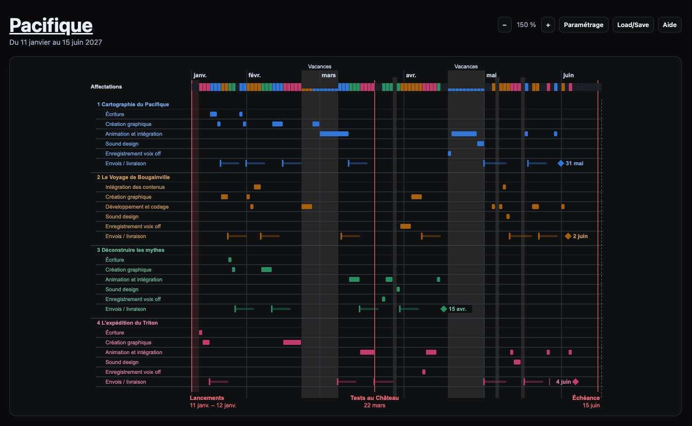

# GanttMesc - Gantt chart creator with MCP connector

GanttMesc stands for “gantt mes couilles”. It is a standalone, interactive Gantt editor that runs in your browser. Edit and print schedules in the HTML editor, and use the JSON files to make changes from an AI chat through MCP.

## Get started

1. Clone this repository or download it using **Code → Download ZIP**.
2. Open [index.html](index.html) in a browser. No installation is required. The interface uses French for French browser settings and English for all other languages. Schedule titles, task names, and other saved content keep their original wording.
3. Use **Load/Save** to create a blank Gantt chart or load a local JSON file. Click the schedule title to rename it.
4. Open **Settings** to set the start and estimated end dates, enter holidays and non-working days, or independently hide weekends, holidays, and day numbers. Use day/month notation for holidays, for example `20/02-7/03; 17/04-2/05; 6/05;`.

## Edit your schedule

| To do this | Use this gesture |
| --- | --- |
| Add a task | Click an empty cell. Right-click to choose the item type. |
| Add a global milestone | Shift-click a day in the calendar header. |
| Edit an item or mark it as a delivery | Double-click the item. Enable **Delivery** to show a dated diamond. |
| Move or resize a block | Drag the block to move it, or drag either edge to change its dates. |
| Set a buffer after an item | Shift-drag from the end of the item or use its editing dialog. Buffer durations exclude weekends and configured holidays. |
| Add a row or child row | Hover over a row title to reveal **+**. Click to add a row or Shift-click to add a child row. |
| Reorder or indent rows | Drag a row title vertically to reorder it, or to the right to make it a child row. |
| Assign the same resource ID to several tasks | Drag a selection from an empty area, then double-click a selected task. When an edit creates a scheduling conflict for the same resource, the task moves to the next available working slot. |
| Zoom horizontally | Scroll the mouse wheel or use the zoom controls. |
| Undo, redo, or delete | Press **Cmd+Z**, **Shift+Cmd+Z**, or **Backspace**, respectively. |

**Help** shows the gestures in the editor. **Load/Save** also lets you save a JSON file, download a self-contained HTML copy, or export to PDF through the browser’s print dialog.

## Use the MCP server with Claude or ChatGPT

The [MCP server](planning-mcp.mjs) runs locally with Node.js. A compatible MCP client can list and read schedules, create plans, add rows, and update tasks. The server reads and writes JSON files in the directory specified by `GANTT_PLANS_DIR`.

- **Claude Desktop:** Add a local server to `claude_desktop_config.json`. Use the absolute path to Node.js as the command, the absolute path to `planning-mcp.mjs` as the argument, and the absolute path to your plans directory as `GANTT_PLANS_DIR`. Restart Claude Desktop.
- **Claude Code and Codex:** Open this repository as a project and follow the local MCP configuration in [AGENTS.md](AGENTS.md). You can also give a compatible assistant the repository URL and ask it to set up the local server.

Example prompt: “Create a schedule called Editing, then add a delivery for June 15, 2027.” Open the resulting JSON in the editor via **Load/Save → Load JSON file**.

- [Local MCP release and installation archive](https://github.com/themesser/ganttmesc/releases/tag/mcp-v1.0.0)
- [JSON schema and examples](MANUEL_JSON.md). This manual is also included in the release archive.
